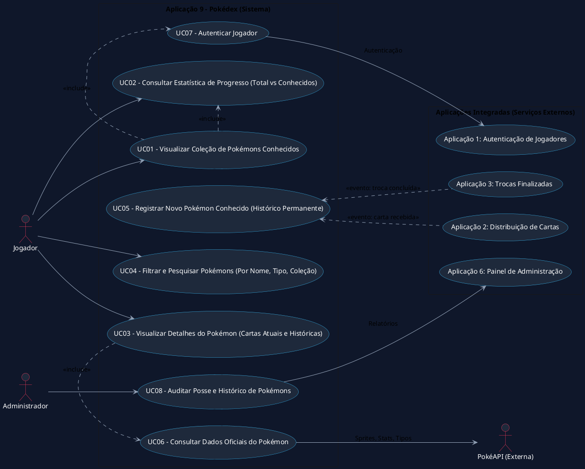

# 📋 Especificação de Caso de Uso - Aplicação 9: Pokédex

## 📌 Visão Geral do Projeto (Sistema de Cards Pokémon)
Este sistema é composto por **9 aplicações microserviços/módulos** interconectados. A **Aplicação 9 (Pokédex)** é responsável por **gerenciar as cartas conhecidas por cada jogador**.

---

## 🎯 Aplicação 9: Pokédex
### 💡 Descrição de Negócio
- Exibe uma interface gráfica intuitiva com a contagem total de Pokémons existentes (PokéAPI) versus quantos o jogador já conheceu (teve em seu baralho).
- **Regra de Ouro**: Mesmo se um jogador trocar ou perder uma carta do seu baralho ativo, as informações dessa carta **permanecem marcadas como "Conhecidas"** na sua Pokédex histórica.

---

## 🗺️ Diagrama de Casos de Uso (PlantUML / Draw.io)

---

## 📑 Detalhamento dos Casos de Uso

### **UC01 - Visualizar Coleção de Pokémons Conhecidos**
- **Ator Principal**: Jogador.
- **Pré-condições**: Jogador autenticado na Aplicação 1.
- **Fluxo Principal**:
  1. O jogador acessa a Pokédex.
  2. O sistema recupera a lista de IDs de Pokémons registrados no histórico permanente do jogador.
  3. O sistema exibe o grid de cartas destacando os Pokémons "Conhecidos" e silenciando os "Não Conhecidos".

### **UC02 - Consultar Estatística de Progresso**
- **Ator Principal**: Jogador.
- **Fluxo Principal**:
  1. O sistema calcula a razão: `(Pokémons Conhecidos pelo Jogador) / (Total de Pokémons da PokéAPI)`.
  2. Apresenta o indicador percentual e a barra de progresso no cabeçalho da Pokédex.

### **UC03 - Visualizar Detalhes do Pokémon**
- **Ator Principal**: Jogador.
- **Fluxo Principal**:
  1. O jogador clica em um card de Pokémon na lista.
  2. O sistema abre o modal exibindo estatísticas (HP, Atk, Def, Speed), tipos, habilidades e histórico de posse.

### **UC05 - Registrar Novo Pokémon Conhecido (Integração de Evento)**
- **Atores**: Aplicação 2 (Distribuição) / Aplicação 3 (Trocas).
- **Gatilho**: Sempre que o jogador recebe 5 cartas iniciais no cadastro ou aceita/conclui uma troca de cartas.
- **Fluxo Principal**:
  1. O serviço externo envia o evento `POKEMON_ADQUIRIDO(jogador_id, pokemon_id)`.
  2. A Pokédex verifica se o `pokemon_id` já consta no histórico do `jogador_id`.
  3. Se não constar, insere o registro permanente no banco de dados da Pokédex.

---

## 🔗 Integrações com as Outras Aplicações do Projeto

| Aplicação | Tipo de Integração | Descrição / Finalidade |
| :--- | :--- | :--- |
| **Aplicação 1 (Jogadores)** | API / JWT | Valida token e permissões do jogador que está acessando a Pokédex. |
| **Aplicação 2 (Distribuição)** | Webhook / Evento | Notifica a Pokédex sobre os 5 Pokémons sorteados no cadastro inicial. |
| **Aplicação 3 (Trocas)** | Webhook / Evento | Notifica a Pokédex sempre que o jogador ganha um novo Pokémon via troca. |
| **Aplicação 4 (Visualização)** | Consulta REST | Permite que a tela de cartas consulte quais Pokémons o jogador já conheceu. |
| **Aplicação 6 (Administração)** | Relatório / Audit | Fornece dados ao admin sobre a taxa de conclusão de Pokédex dos jogadores. |
| **PokéAPI (Externa)** | REST / HTTP | Fornece artes em HD, sprites, tipos, habitats e stats de base. |
